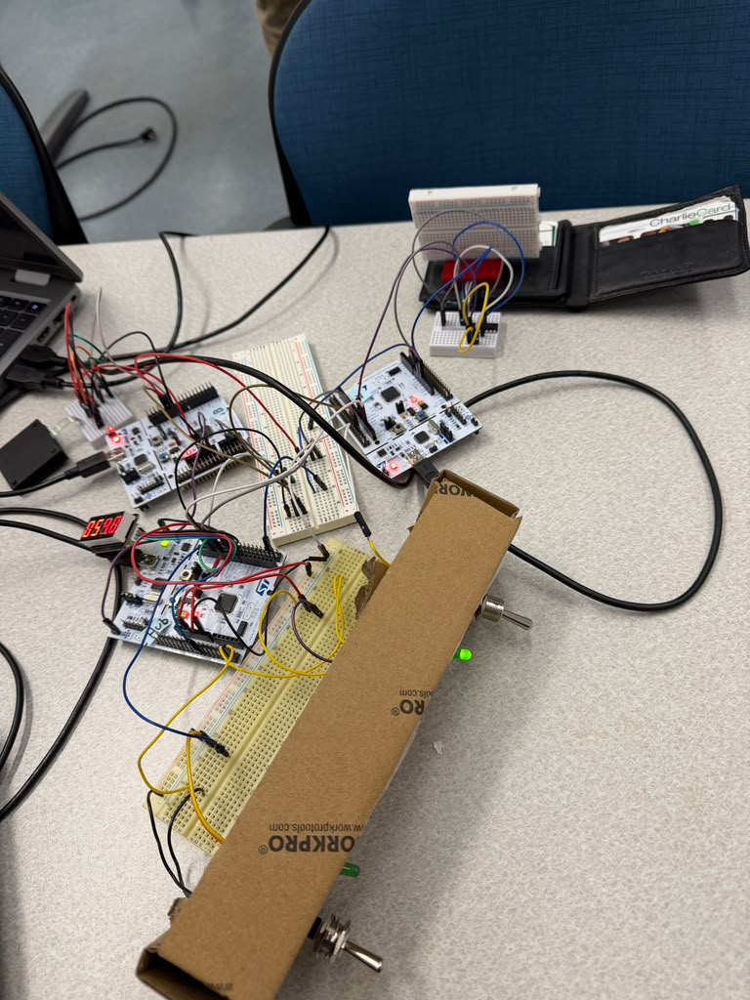
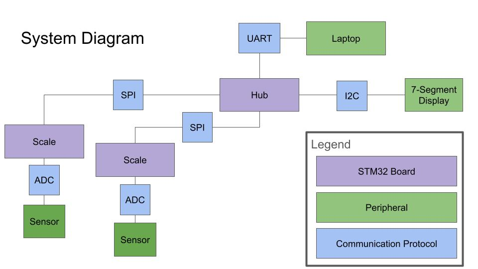
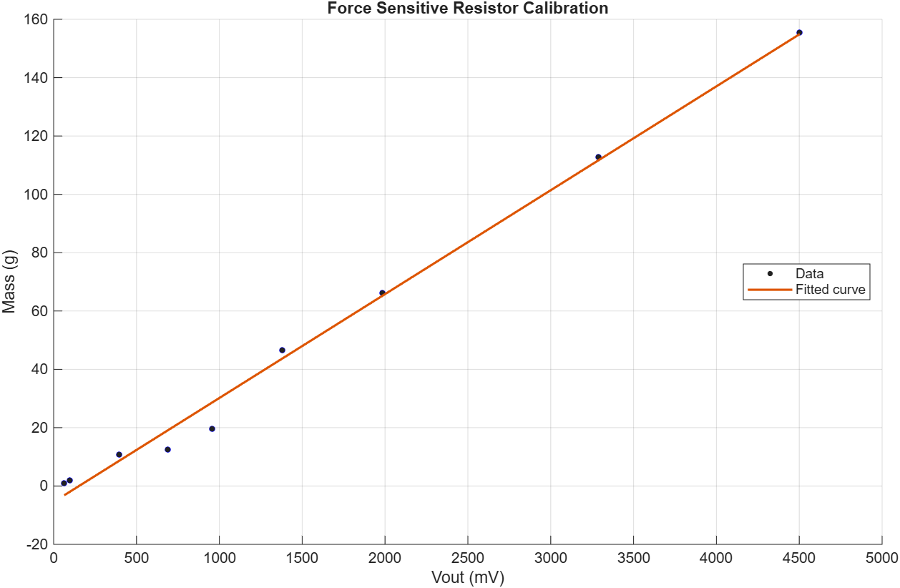

# STM Scale
Aaditya Rao, Antara Mazumdar, Connor Honag, Tan Vu

## Overview
We created a system where a user can utilize a central control system and observe the masses of multiple scales on either a physical display or through a custom debug software. The user control is a central panel with a switch for each scale, with local tare buttons on each scale.

We divided the workload for this project based on our learning goals and interests. Tan worked on data collection through the sensor board, using the ADC. Connor worked on the 7-segment display using I2C. Antara worked on the UART telemetry and display, as well as integrating the user input (switches). Aaditya worked on inter-board communication, using SPI to relay the measurements from both sensor boards to the controller board. 

## Demo Video
Video Link - https://youtube.com/shorts/9ZTYr1ZSDXA?feature=share




## System Architecture
The system consists of a controller hub, a debug laptop, and an indeterminate number of scales. The controller hub is an STM32 that orchestrates communications and displays data on a 7-segment display. One switch for each scale controls if the scale’s data stream is on or off. The scale most recently turned on is the active scale which has its values displayed. The laptop allows for viewing of multiple masses at once and observing longitudinal data. For the purposes of demonstration we utilized two sensors, meaning an additional two STM32 platforms, each connected to a force sensor with a small mechanical assembly to contain the sensor. The USER button on the sensor STM32s can be pressed to initiate a tare that sets the display value to 0.



## Subsystems
### Sensor Board
#### Calibration
The hardware consists of a Force-Sensitive Resistor, 
Experimental data of ADC reading as a function of mass was collected, and the curve of best fit was used as the transfer function.



#### ADC
ADC conversions are triggered by a hardware timer at 5 kHz. Within the timer control register, the Trigger Out (TRGO) signal sends an Update Event (UEV). The hardware ADC is tied to the rising edge of the trigger, enabling periodic conversions.

ADC results are stored into a split buffer using DMA - the CPU processes the first half while DMA populates 2nd half. 

### Controller Board
The controller board is responsible for coordinating between the two scales and both the methods of displaying the readings. It takes in user input in the form of two SPST switches that are used to decide which scale reading is displayed. When a switch is toggled on, the corresponding LED lights up. The switches are triggered on both the rising and falling edge as an EXTI input. The callback function checks which pin/switch is toggled, turns on the corresponding LED and stores the board ID in the ```active_scale``` variable.

Both boards are always sending data through SPI that gets parsed and placed into ```scales[idx]``` where ```idx``` is the board ID. However, the switch toggling decides when the data is displayed. For UART, as long as the switch is toggled on, the data is transmitted; this means that if both scales are toggled on, we can see both readings on the UART telemetry stream display. For the 7-segment display, only the latest switch toggled on is registered and the weight from the corresponding board is displayed.

UART_Send_Scale(i) - triggered every time an SPI frame is read using the same ```poll_due()``` function that SPI_Read_Scale(i) uses. This function uses the HAL_UART_Transmit function to send a comma-separated parsed version of the scales struct that the SPI writes, along with a board ID number. 

The UART stream is visualized using python by accessing the port on the laptop (through pyserial) that is connected to the controller board. The code resides in 

#### Display
This project utilizes a VK16K33 7-segment display, which receives instructions via the I2C protocol. To update the screen, the microcontroller transmits an 11-byte payload to the display's internal RAM starting at register 0x00, which contains the specific 8-bit hex codes required to light up the correct segments for each digit.

For displaying live masses from a scale, a hardware timer (TIM3) is configured to trigger at a frequency of 2Hz. This refresh rate is deliberately chosen to be fast enough to feel responsive, yet slow enough to remain comfortably human-readable. This timer triggers an interrupt that sets a flag, prompting the non-blocking main loop to execute the weight display update. The STM32 takes the mass from the frame sent across SPI. As the number is known to be no more than 171 grams, it is multiplied by 10 to get 4 digits to the left of the decimal, then divided by powers of ten to isolate the individual digits. These values are then converted by referencing a known table taken from the display’s datasheet so that the proper register value can be set.

The display also briefly shows the ID of the active scale when toggled. Whenever the scale select switch is flipped, an EXTI hardware interrupt flags the main loop. The main loop then calls a function to display the active scale's ID. This function hardcodes the segment values for "S", "C", and the colon, while dynamically computing the active scale number for the final digits.

This function also resets a counter variable “ID_showing” to zero. This counter is incremented every time the 500ms “Display_Value” routine attempts to run, intentionally blocking new weight data from being transmitted until the counter reaches 5. This allows the display to show the ID for an arbitrarily chosen time to give the user enough time to comfortably read the scale ID before the live mass data resumes.

If no scale is active, the controller loads the display’s entire register with zeros which turns off the peripheral’s lights.

## Cross-Board Communication
Cross board communication is implemented through SPI. The SPI link follows a master-slave architecture with two sensor boards acting as the slave and one controller board being the master. Each sensor samples at 5kHz using a timer and a DMA. The sensor values are averaged into an 8 sample reading and loaded into the SPI DMA buffer at 625Hz. The controller requests data from each board at 100Hz, and emits a 1MHz clock signal for SPI. A request is defined as pulling the designated chip select pin low. The received data is stored in the scales[] array. The link implements fault tolerance in two ways. First, each frame contains a checksum bit which xORs the other contents of the frame. The checksum bit is validated on the controller side. In the case a fault causes chip select to be pulled high prior to the entire frame transmitting, the SPI clears the DMA buffer to prevent packet corruption.


#### SPI Function Call Stack
**Sensor board**
- TIM2 starts each ADC conversion.
    - DMA2 writes the results into a circular 16-sample buffer.
        - HAL_ADC_ConvHalfCpltCallback / HAL_ADC_ConvCpltCallback fire every 8 samples:
            - PROCESS_ADC_BUFFER(): averages the samples, applies the tare, computes mass.
            - SPI_UPDATE_FRAME():
                - If CS is low, MISO is busy so it skips this update.
                - If SPI is busy but CS is high, the last frame wasn’t read so it calls SPI_RESYNC(), which aborts the DMA and resets SPI1
                - SPI_LOAD_FRAME(): packages the frame and calls HAL_SPI_Transmit_DMA() when CS is low
- HAL_SPI_TxCpltCallback: sent when full frame was transmitted
    - clears the flags that were sent,
    - calls SPI_LOAD_FRAME() again so a frame is always ready.
- HAL_SPI_ErrorCallback (CS went high mid-frame):
    - SPI_RESYNC(), then SPI_LOAD_FRAME().

**Controller board**
- TIM2 interrupt (100 Hz):
    - sets poll_due = 1. Polls sample.
- Main loop, when poll_due is set:
    - SPI_Read_Scale(0), then SPI_Read_Scale(1):
        - pull that board’s CS low
        - HAL_SPI_TransmitReceive() receives 10 frame bytes
        - raise CS
        - check the sync byte and checksum, then write scales[idx]. If the board is not connected or checksum false, set valid = 0.


**Sensor Board Features**

SPI TX DMA runs off of DMA2 Stream3. Both DMA interrupts for ADC and SPI are P0 so they can never interrupt each other. A frame is always loaded into DMA.

*Frame Schema*
Each frame contains 9x, 1 byte (8bit) packets.
| Byte | Field | Justification |
| --- | --- | --- |
| 0 | `0xA5` Sync | Common sync bit used to identify the start of a frame. |
| 1 | Sample Counter | Increments from 0–255 with every reading. Allows the controller to identify frame sequence and freshness. |
| 2–3 | Mass | 16-bit sample split into two 1-byte packets. |
| 4–5 | Raw ADC Value | 12-bit ADC value split into two 1-byte packets. |
| 6–7 | Tare ADC | Raw ADC value with tare applied, split into two 1-byte packets. |
| 8 | Flags | Bit 0 indicates whether tare was applied during a frame. Other bits are reserved for future logic. |
| 9 | XOR Checksum | XOR of all previous bytes. The controller checks the checksum to validate frame integrity. |


#### Tradeoffs
- This implementation is TX only. While this is simpler, the master cannot send commands. 
- Every board needs its own CS wire.
- Newer data overwrites. This ensures that the controller gets the latest data, but trades lower resolution of the load cell.

#### Checksum
- XOR of bytes 0-8
- In the case of a bit flip or bit shift, the xor checksum is false which flags on the controller side.
 -Checksum is validated on the controller side.

#### Controller Board Features
#### Polling 
Polling is used because the controller board has to start every transaction in SPI
The polling is in the main loop because lower priority interrupts are blocked inside the callback. This means that other lower priority interrupts like switches, display, uart would be blocked.
HAL_SPI relies on SysTic Interrupt. Inside a different callback, systick cannot run so the HAL_SPI timeout would be unable to run.
Display refresh code reads Scales[] from the main loop. If Scales[] was read at any moment, the display / UART could read a mixture of values. In main, these processes are sequential.

#### Clock
| Signal | Value | Defined by | Justification |
|---|---|---|---|
| ADC Sampling | 5kHz | Sensor TIM2 | Reasonable rate from datasheet and testing |
| SPI Frame Update | 625Hz | ADC / 2 | Each frame is an average of 8 samples which smooths the jitter. |
| SPI Clock (SCK) | 1 MHz | Controller SPI1 | Arbitrary. Theoretical limit is the highest frequency MISO wire / breadboard impedance could handle. |
| Controller Polling | 100Hz | Controller TIM2 | New reading every 10 ms. |
| Display Refresh | 2Hz | Controller TIM3 | Slow enough refresh rate to be comfortably human readable without being excessively long |


## Challenges
Our first challenge was to determine the weighing scale setup for the force sensor. Because the surface area of the sensor was so small, we needed to design a mechanical enclosure that would allow for a larger surface area to deliver the force on the small sensor.

### Pivoting from CAN

Initial interboard communication was through CAN. The structure was each sensor board would publish frames to the CAN bus, which the Controller board would receive through an interrupt. We encountered multiple issues which informed our decision to pivot to a different communications protocol.

The primary issue was with the CAN transceiver hardware.

We used a SN65HVD230 can transceiver. In nominal operation, the CANH and CANL pins should be at 2.3V relative to GND, and 0V relative to each other on a recessive bit (CANTX High) and 1.5V relative on a dominant bit  (CANTX Low). Vref should also be at 1.65 (3.3/2). 

During transceiver bring-up, shorting CANTX low and high would not change the output of CANH-CANL. This is likely due to the transceiver board being faulty.

Another quirk about the board was onboard termination resistors. The board did not have a datasheet, therefore it took a second to realize the CAN bus was higher in resistance than it should be as external resistors were initially added.

## Integration
Since each of us worked on different subsystems that ran on the same 3 boards, integration was the most challenging part of our project. While we had made some initial agreements on how data will be sent, when it will be read, etc, we realized we had each independently made some assumptions and decisions that did not match. Our first integration issue was the system clock. Some of us had set it up using the internal clock (HSI), while others used the on-board oscillator (HSE). This led to the timers firing at different rates than intended since the internal dividers and clock speeds were set differently.

## Debugging
We mostly used the Live Expressions tab of the STMCubeIDE to debug our code, assigning dummy variables wherever necessary. A majority of our issues initially were due to mismatched wiring and initializations across boards, as well as faulty jumper cables. Since we had each only done our separate parts, we also spent some time understanding what the entirety of the code did so that we could debug efficiently.


## AI Usage
- Aaditya - I used AI to-
    - Set up the multi board debugging in CubeIDE
    - Understand key tradeoffs and quirks with SPI and HAL_SPI
    - Debug specific errors in HAL_SPI
    - Read through my proposed architecture and provide feedback on key limitations or issues I would run into.
- Antara - I used AI to -
    - Set up and debug the UART visualization in python
    - Confirm that 
